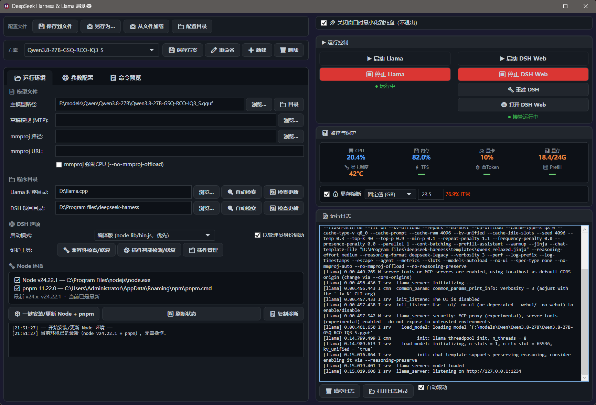

# LlamaDSH 启动器

对llama.cpp和DeepSeek Harness集中管理，适合本地部署的同学
方便管理不同模型的不同参数配置方案，同时能够一键升级llama.cpp、node、deepseek harness；还能针对DSH的插件兼容性进行一键修复；一键安装、更新、卸载、停用插件；DSH更新频繁，旧插件容易过期，插件管理专门添加了版本豁免的实验性功能。
更多功能自行体验，本软件已成为我的后台常驻软件。另外给本地部署的同学推荐下我做的DSH上下文管理插件，128K、64K、甚至32k上下文的本地模型都能把活儿干起来！当然线上大模型api也能进行优质压缩，绝对比自带的压缩降智低很多：https://github.com/chocobo77/dsh-infinite-context



（以下是我本地的Qwen3.8 27B写的，将就看看）
## 功能

### 参数面板

llama-server 的参数按官方 help 分成通用与加载、采样控制、推测解码、服务与扩展四组，组内再按用途分小节。勾一个参数就填一行，右边一栏列出当前勾了哪些，可以按关键字过滤。

参数之间有依赖和互斥，比如推测解码的子参数要等 spec-type 不填 none 才有意义。勾了不该勾的，底部会说明原因，生成命令时也会剔掉。

参数表放在 Resources/llama_params.yml。llama.cpp 升级之后改这文件，点「重载参数配置」当场生效，不用重启程序。

### 命令预览

「命令预览」页显示当前会执行的完整命令：程序路径、每个参数的取值、以及你在编辑模式里追加的自定义参数（橙色显示，跟自动生成的区分开）。

命令可以复制走，拿到终端里手动跑，排查启动问题的时候好用。

### 方案与配置文件

一套参数存一个方案。下拉切换方案即可切换模型、参数。

配置文件：「保存到文件」写回默认路径，「另存为」导出成新文件，「从文件加载」用磁盘上的文件覆盖当前配置，「配置目录」可以改存放位置。

### 启动控制

右侧「运行控制」管两件事。

llama 一个启动、一个停止，启动后显示进程有没有活着。

DSH 有启动 Web、停止、重建、打开网页。启动方式有三种：编译产物（node apps/cli/lib/bin.js，最快）、源码模式（pnpm dsh，依赖齐全但慢）、npx（临时下载）。程序自己选，编译产物不在就往下退。

需要提权的时候勾「以管理员身份启动 DSH」，启动时弹 UAC。

### 日志与诊断

底部日志区实时显示子进程输出，能自动滚动、清空、打开日志目录。连续重复的行会折叠；DSH 的纯噪音行折成一行计数，并写明全文在哪个 boot log 里。

日志目录 `~\.dsh_launcher_logs\` 下 run.log / info.log / error.log / crash.log 每份超过 4 MB 就滚动出 `.1 .2 .3`（保留 3 份历史）。run.log 逐行带完整时间戳，并且运行中每攒够 200 行或每 5 秒就落一次盘——以前只在退出时整段写，崩溃或被结束进程时本次会话一行都不留，日期戳还是「落盘时刻」而不是「发生时刻」。

日志里的访问凭据（DSH 的 `?token=`、JSON 里的 `token` 字段、`Bearer …`）一律写成 `‹已隐藏›`；启动时还会把改动之前已经落盘的那些一次性抹掉，所以「复制诊断」粘出去的内容不会带密钥。

出问题点「复制诊断」，会把环境信息、运行时版本、以及 run.log / error.log / crash.log 各自最后 40 行复制到剪贴板（只从文件末尾读 128 KB，不会为了几十行把整个日志读进内存），粘贴出来就能看出问题在哪。

Agent 接口的 `GET /api/logs` 支持 `n=`、`after=<序号>` 游标、`level=error|warn|info`、`grep=文本`；响应带 `boot`（本次启动标识）、`ring`、`seq_first_available` 和 `gap`（游标已经失效，客户端应当重置——游标每次进程启动都从 1 重来）。命令行同义：`cli logs 200 level=error`。

### Node 环境

「运行环境」页里有一块 Node 环境。

检测会显示 node 和 pnpm 的版本、路径，判断是否满足 v24 和 pnpm 的要求。

「一键安装/更新」下载官方 v24 安装包，先验体积再验 SHA-256（取不到校验和时改用数字签名验签），静默装上，然后用 npm 装 pnpm，最后实际跑一次 pnpm --version 确认能用。

装完顺手检查 DSH 的 node_modules 有没有失效链接。

整个过程逐步写日志，超时会说明卡在哪一步。

### DSH 维护

「兼容性检查/修复」扫一遍 DSH 安装：bundle 激活表、失效的补丁、死依赖声明、node_modules 里的悬空链接。pnpm 的软链存的是绝对路径，DSH 目录搬过家就会全部断掉，这是最常见的一种坏法。能自动修的当场修，改之前先备份。

「插件智能检测/修复」处理插件和 DSH 版本对不上的情况，包括 peer 依赖缺失、版本越界。

「插件管理」是单独的窗口，可以启用、停用、升级、卸载，也能装本地插件。

启动 DSH 如果报 ERR_MODULE_NOT_FOUND，程序会先重连链接再重试一次，不用手动去点兼容性修复。

### 监控与保护

显示 CPU、内存、显卡占用、显存占用、显卡温度，以及 llama 的 TPS、首 token 延迟、prefill 速度。

显存熔断设一个阈值（百分比或 GB），超过就自动停掉 llama，免得显存打满把系统拖死。

显存预估拆成权重、KV 缓存、计算图缓冲、固定开销四项分开算。混合架构模型（滑窗 / 线性注意力）按全注意力层数折算 KV，不会把 64 层全按线性增长去算。

### 托盘

关窗口默认最小化到托盘，进程不退出。双击托盘图标恢复窗口，右键菜单里能真正退出。

窗口隐藏或最小化时自动进入**轻量化模式**（与 Linux 侧同款设计）：监控采样降到 30 秒一拍，llama 和 DSH 都没跑时进一步降到 60 秒纯休眠、零采样，后台几乎不占资源；显存熔断另有独立的 3 秒显存探针（NVML 进程内直读，不spawn子进程），降频不降低熔断响应。恢复窗口、切回监测页都会立刻打断休眠恢复全速刷新。托盘右键菜单里也有"轻量化模式(后台低频保活)"复选，可以在窗口开着时手动开/关。

## Agent 调用 / 调试接口

Windows 启动器内置本机 HTTP 控制面：**只绑 127.0.0.1**（默认端口 17325），X-Auth token 鉴权，出入全是 JSON。配套一个控制台小工具 `llamadsh-cli.exe`（随安装包分发），给 agent / 脚本 / 排障用：

```
llamadsh-cli status            全量状态快照（llama/dsh/GPU/熔断/轻量档/方案/路径）
llamadsh-cli monitor           监控页同款数据（采样 + slots + 12 条速度历史）
llamadsh-cli logs 300          运行日志尾部
llamadsh-cli llama start|stop  启停 llama-server（带端口/模型预检，失败返回 JSON 原因）
llamadsh-cli dsh start|stop    启停 DSH
llamadsh-cli light toggle      托盘轻量档
llamadsh-cli window hide       隐藏到托盘 / show 恢复
llamadsh-cli profiles          方案列表；profile use <名> 切换
llamadsh-cli breaker set pct 90  显存熔断配置
llamadsh-cli raw slots         直连 llama API 透传（slots/props/health）
llamadsh-cli api GET /api/status 任意端点逃生舱
llamadsh-cli quit              退出（默认先停服务）
```

退出码 `0` 成功 / `1` 业务失败或 HTTP 4xx-5xx / `2` 接口不可达或已禁用 / `3` 超时(结果未知，**勿直接重试**，先用 `status`/`logs` 确认)，stdout 永远是一行可直接解析的 JSON。同样的能力也能经 `LlamaDSH_Launcher.exe cli <命令>` 使用。等待秒数用 `LLAMADSH_AGENT_TIMEOUT`(5–3600，默认 600)放宽。

发现文件 `~/.dsh_launcher_logs/agent.json`（Windows 下即 `%USERPROFILE%\.dsh_launcher_logs\agent.json`）= `{"port":…,"token":"…","enabled":true}`，**两个启动器都写**这一份（Linux 端默认端口 8788，端口被占会顺延，所以文件里的 port 是本次真正绑上的端口；Linux 另留 `~/.dsh_launcher_token` 纯文本 token 作向后兼容）。它是“最后一次启动”的记录，进程退出不会清理——先 `GET /api/ping` 再当服务在跑。curl 用：`curl -H "X-Auth: <token>" http://127.0.0.1:17325/api/status`（也接受 `Authorization: Bearer <token>`）。禁用接口：`agent.json` 里 `"enabled": false` 或环境变量 `LLAMADSH_AGENT_DISABLE=1`；改端口用 `LLAMADSH_AGENT_PORT`；临时换 token 用 `LLAMADSH_AGENT_TOKEN`（env 里的 token **不会**被写进 `agent.json`，`cli` 也按同一优先级读 env）。

端点命名、字段别名口径（`llama.running`/`llama.status`、`profile_name`、`gpu_temp`/`gpu_power`/`net_rx`、`sampled_at`/`sampled_at_utc`、`logs` 的 `n`/`after`）、任务模型（`{"job":id}` → `/api/job`）与两端差异清单见 **`docs/API-CONTRACT.md`**；Linux 侧实现见 `LlamaDSH_Launcher_Linux/main.py` 的 `ROUTES`。

## 环境要求

- Windows 10 / 11 x64
- llama.cpp 目录，里面有 llama-server.exe
- DeepSeek Harness 源码目录，含 apps/cli
- node 24 与 pnpm，没有可以用程序里的一键安装

发布版自带运行时，从源码跑需要 .NET 8 桌面运行时。

## 快速开始

1. 打开程序，在「运行环境」页填模型文件、llama.cpp 目录、DSH 目录
2. 点「刷新状态」，看 node 和 pnpm 是否就绪，缺哪个点「一键安装/更新」
3. 到「参数配置」页按需勾选，在「命令预览」页核对生成的命令
4. 点「启动 Llama」，等日志里出现 listening，再启动 DSH
5. 浏览器打开 http://127.0.0.1:3080

## 目录

- LlamaDSH_Launcher_CS：主程序，WPF
  - Services：进程执行、工具链探测、兼容修复、更新、GPU 采样
  - Resources/llama_params.yml：参数表
- LlamaDSH_Launcher_Linux：Linux 侧的 webui 版本，实验性质，能用但没细磨
- tests/SmokeTests：不依赖 NuGet 的冒烟测试，覆盖进程超时、大输出、验签、日志轮转
- WmiProbe：读进程命令行的小工具

## 常见问题

**启动 DSH 报 Cannot find package '@deepseek-ai/...'**

DSH 目录搬过家，pnpm 的软链还指着旧路径。点「兼容性修复」重连；新版直接点启动也行，程序会先自愈再重试。还不行就在 DSH 目录跑一次 pnpm install。

**提示找不到 node 24**

只认 v24 及以上。用「一键安装/更新」装，或者把 node 目录加进 PATH 后点「自动检索」。

**改了参数但生成的命令没变**

点「重载参数配置」。参数表是从 Resources/llama_params.yml 读的，改完不用重启。

**显存不够，加载到一半就退出**

把 gpu-layers 调小，或者开显存熔断留点余量。日志里的 cudaMalloc 报错基本就是这个原因。

**点「启动模型」后只看到刷屏报错，看不到失败原因**

模型因显存已被别的进程占满而秒退时，旧版会陷入每 3 秒一次的未处理异常刷屏（`No process is associated with this object.`），而那句「Llama 异常退出 (退出码 N)…」正好排在抛点之后，一次都没打出来。现在存活判定统一走一层安全判定（进程对象已与进程脱钩就按已退出处理，并把引用清掉），退出处理外层还有兜底；界面会直接把原因说到脸上：日志里出现 CUDA 显存分配失败就点名「显存不够，先结束占着显存的进程，或调小 gpu-layers / ctx-size」。

**升级或构建时报 gputemp.exe 被占用**

上一轮启动器被强杀/崩溃会把 GPU 采样子进程（`gputemp --loop`）留下成孤儿，几个并存就锁住了这个文件。启动器启动时会先清掉遗留的采样进程，并在 info.log 记一行「清理了 N 个上一轮遗留的 gputemp 采样进程」。

**启动器不接管已经在跑的 DSH（面板显示未运行，但 3080 确实有人监听）**

端口上有监听只说明"有人占着"，不足以证明那是 DSH——无校验接管后点「停止」会连用户的无关进程树一起杀。判定分三层：进程名 → 命令行 → 该端口的 HTTP 指纹（不带 token 访问 `/` 会回 401 + `dsh web authentication required`，这句只有 DSH 会发）。DSH 若以管理员权限启动，而启动器没有提权，WMI 读不到它的命令行，此时靠 HTTP 指纹照样能接管；日志里会写明是按哪层判定的。指纹也不成立时（多半真是别的程序占了 3080）既不接管也不停止，请自行结束它或换个 DSH 端口。

**托盘图标不见了**

系统设置里把它设成常显。程序退出会清掉图标，重启后恢复。

## 构建

    dotnet build LlamaDSH_Launcher_CS/LlamaDSH_Launcher.csproj

打安装包运行 一键封包.cmd，内部是 dotnet publish 单文件加 Inno Setup。

跑测试：

    dotnet run --project tests/SmokeTests/SmokeTests.csproj

## 参数表

当前对齐 llama-server 0.7.0-dev build 11680。升级 llama.cpp 之后，把新版 --help 存成文件，和 llama_params.yml 逐条对一遍，具体做法写在文件开头。

## 许可证

MIT，见 LICENSE。改完想怎么用都行，留着版权声明就好。
