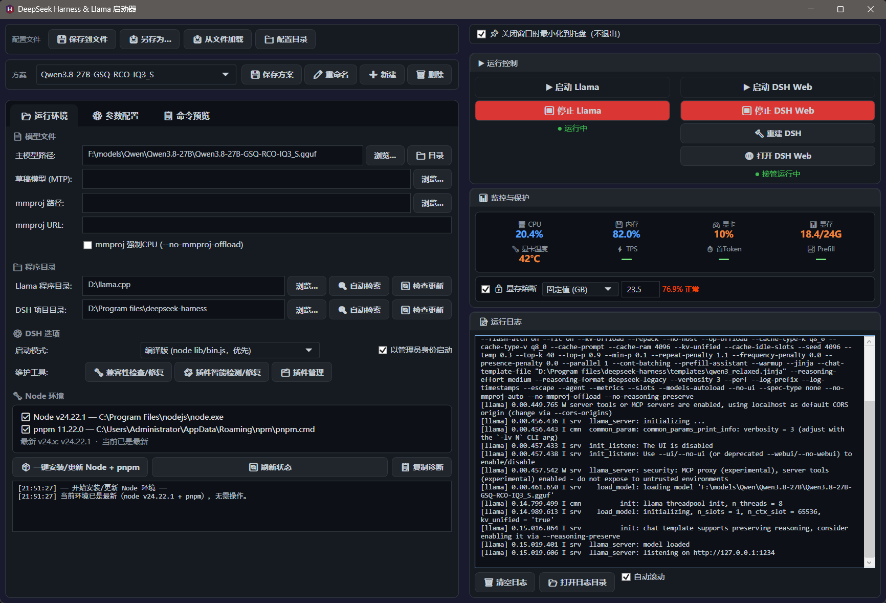

# LlamaDSH 启动器

对llama.cpp和DeepSeek Harness集中管理，适合本地部署的同学
方便管理不同模型的不同参数配置方案，同时能够一键升级llama.cpp、node、deepseek harness；还能针对DSH的插件兼容性进行一键修复；一键安装、更新、卸载、停用插件；DSH更新频繁，旧插件容易过期，插件管理专门添加了版本豁免的实验性功能。
更多功能自行体验，本软件已成为我的后台常驻软件。另外给本地部署的同学推荐下我做的DSH上下文管理插件，128K、64K、甚至32k上下文的本地模型都能把活儿干起来！当然线上大模型api也能进行优质压缩，绝对比自带的压缩降智低很多：https://github.com/chocobo77/dsh-infinite-context

（以下是我本地的Qwen3.8 27B写的，将就看看）
## 功能

### 参数面板

llama-server 的参数按官方 help 分成通用与加载、采样控制、推测解码、服务与扩展四组，组内再按用途分小节。勾一个参数就填一行，右边一栏列出当前勾了哪些，可以按关键字过滤。

参数之间有依赖和互斥，比如推测解码的子参数要等 spec-type 不填 none 才有意义。勾了不该勾的，底部会说明原因，生成命令时也会剔掉。

参数表放在 Resources/llama_params.yml。llama.cpp 升级之后改这文件，点「重载参数配置」当场生效，不用重启程序。

### 命令预览

「命令预览」页显示当前会执行的完整命令：程序路径、每个参数的取值、以及你在编辑模式里追加的自定义参数（橙色显示，跟自动生成的区分开）。

命令可以复制走，拿到终端里手动跑，排查启动问题的时候好用。

### 方案与配置文件

一套参数存一个方案。下拉切换方案即可切换模型、参数。

配置文件：「保存到文件」写回默认路径，「另存为」导出成新文件，「从文件加载」用磁盘上的文件覆盖当前配置，「配置目录」可以改存放位置。

### 启动控制

右侧「运行控制」管两件事。

llama 一个启动、一个停止，启动后显示进程有没有活着。

DSH 有启动 Web、停止、重建、打开网页。启动方式有三种：编译产物（node apps/cli/lib/bin.js，最快）、源码模式（pnpm dsh，依赖齐全但慢）、npx（临时下载）。程序自己选，编译产物不在就往下退。

需要提权的时候勾「以管理员身份启动 DSH」，启动时弹 UAC。

### 日志与诊断

底部日志区实时显示子进程输出，带时间戳，能自动滚动、清空、打开日志目录。

出问题点「复制诊断」，会把界面上的日志、最近 40 行 error.log 和 crash.log、系统版本和运行时版本一起复制到剪贴板，粘贴出来就能看出问题在哪。

### Node 环境

「运行环境」页里有一块 Node 环境。

检测会显示 node 和 pnpm 的版本、路径，判断是否满足 v24 和 pnpm 的要求。

「一键安装/更新」下载官方 v24 安装包，先验体积再验 SHA-256（取不到校验和时改用数字签名验签），静默装上，然后用 npm 装 pnpm，最后实际跑一次 pnpm --version 确认能用。

装完顺手检查 DSH 的 node_modules 有没有失效链接。

整个过程逐步写日志，超时会说明卡在哪一步。

### DSH 维护

「兼容性检查/修复」扫一遍 DSH 安装：bundle 激活表、失效的补丁、死依赖声明、node_modules 里的悬空链接。pnpm 的软链存的是绝对路径，DSH 目录搬过家就会全部断掉，这是最常见的一种坏法。能自动修的当场修，改之前先备份。

「插件智能检测/修复」处理插件和 DSH 版本对不上的情况，包括 peer 依赖缺失、版本越界。

「插件管理」是单独的窗口，可以启用、停用、升级、卸载，也能装本地插件。

启动 DSH 如果报 ERR_MODULE_NOT_FOUND，程序会先重连链接再重试一次，不用手动去点兼容性修复。

### 监控与保护

显示 CPU、内存、显卡占用、显存占用、显卡温度，以及 llama 的 TPS、首 token 延迟、prefill 速度。

显存熔断设一个阈值（百分比或 GB），超过就自动停掉 llama，免得显存打满把系统拖死。

### 托盘

关窗口默认最小化到托盘，进程不退出。双击托盘图标恢复窗口，右键菜单里能真正退出。

## 环境要求

- Windows 10 / 11 x64
- llama.cpp 目录，里面有 llama-server.exe
- DeepSeek Harness 源码目录，含 apps/cli
- node 24 与 pnpm，没有可以用程序里的一键安装

发布版自带运行时，从源码跑需要 .NET 8 桌面运行时。

## 快速开始

1. 打开程序，在「运行环境」页填模型文件、llama.cpp 目录、DSH 目录
2. 点「刷新状态」，看 node 和 pnpm 是否就绪，缺哪个点「一键安装/更新」
3. 到「参数配置」页按需勾选，在「命令预览」页核对生成的命令
4. 点「启动 Llama」，等日志里出现 listening，再启动 DSH
5. 浏览器打开 http://127.0.0.1:3080

## 目录

- LlamaDSH_Launcher_CS：主程序，WPF
  - Services：进程执行、工具链探测、兼容修复、更新、GPU 采样
  - Resources/llama_params.yml：参数表
- LlamaDSH_Launcher_Linux：Linux 侧的 webui 版本，实验性质，能用但没细磨
- tests/SmokeTests：不依赖 NuGet 的冒烟测试，覆盖进程超时、大输出、验签、日志轮转
- WmiProbe：读进程命令行的小工具

## 常见问题

**启动 DSH 报 Cannot find package '@deepseek-ai/...'**

DSH 目录搬过家，pnpm 的软链还指着旧路径。点「兼容性修复」重连；新版直接点启动也行，程序会先自愈再重试。还不行就在 DSH 目录跑一次 pnpm install。

**提示找不到 node 24**

只认 v24 及以上。用「一键安装/更新」装，或者把 node 目录加进 PATH 后点「自动检索」。

**改了参数但生成的命令没变**

点「重载参数配置」。参数表是从 Resources/llama_params.yml 读的，改完不用重启。

**显存不够，加载到一半就退出**

把 gpu-layers 调小，或者开显存熔断留点余量。日志里的 cudaMalloc 报错基本就是这个原因。

**托盘图标不见了**

系统设置里把它设成常显。程序退出会清掉图标，重启后恢复。

## 构建

    dotnet build LlamaDSH_Launcher_CS/LlamaDSH_Launcher.csproj

打安装包运行 一键封包.cmd，内部是 dotnet publish 单文件加 Inno Setup。

跑测试：

    dotnet run --project tests/SmokeTests/SmokeTests.csproj

## 参数表

当前对齐 llama-server 0.7.0-dev build 11680。升级 llama.cpp 之后，把新版 --help 存成文件，和 llama_params.yml 逐条对一遍，具体做法写在文件开头。

## 许可证

MIT，见 LICENSE。改完想怎么用都行，留着版权声明就好。
