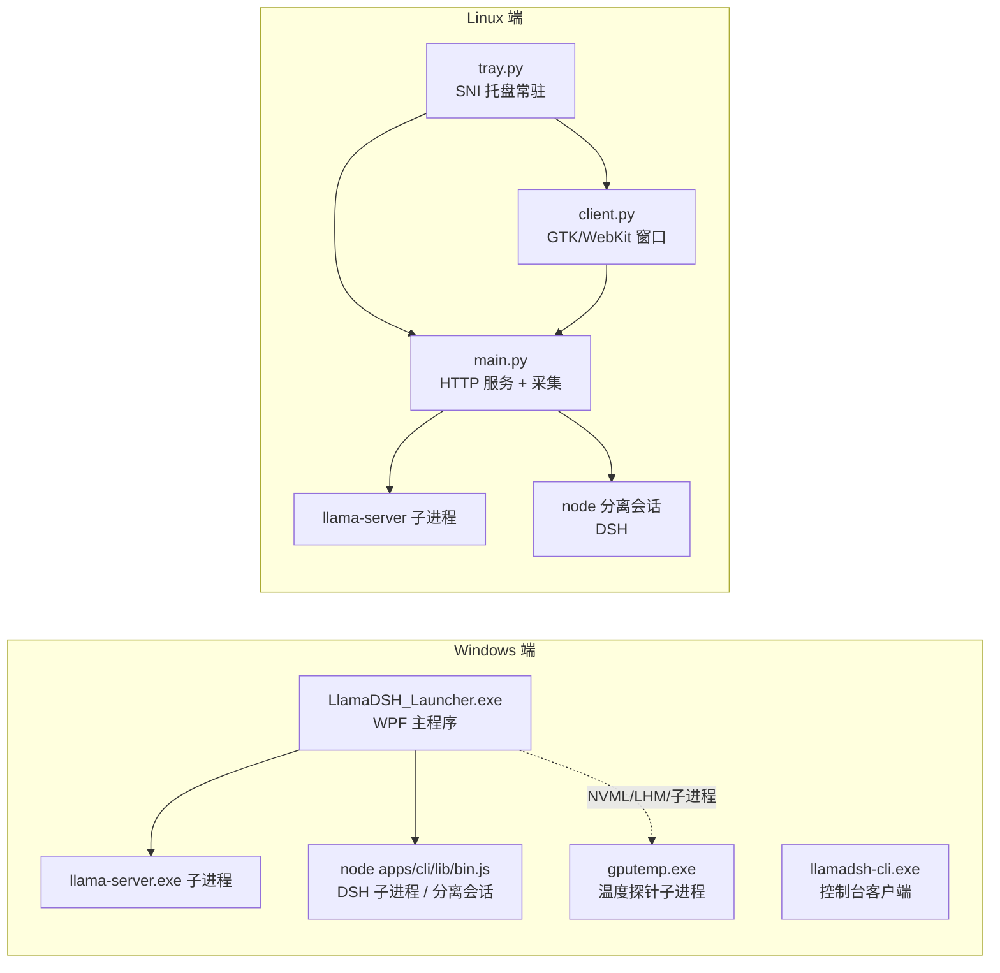

# 02 整体架构

## 双端总览

- **Windows**：单进程 UI 承载一切（MainWindow 1.1 万行），子进程为 llama-server（PIPE 直启）、DSH（可分离会话 + 提权）、gputemp（温度长驻探针）。HTTP 控制面与 UI 同进程（`AgentApi`）。
- **Linux**：三进程分工——`main.py` 是核心（HTTP 服务 + 路由 + 采集线程），`tray.py` 是不导 GTK 的微型托盘常驻（~25-30MB），`client.py` 是浏览器窗口壳。关窗 = 窗口进程退出、服务与 llama/DSH 继续跑（分离会话），内存从 ~600MB 回落到 ~64MB。

## 跨端公共设计

### 1. 参数 schema（参数表）

真源是 `llama_params.yml`（Windows 内嵌 + exe 旁 + 用户 override 三层加载；Linux 内置 `webui/llama_params_default.yml` 兜底）。声明式结构：

- `meta`：schema 版本号（当前 12）单调递增驱动自动升级（旧版自动备份 `.bak`）；`adapt` 记录对齐的 llama-server build（当前 0.7.0-dev b11680）。
- `groups`：7 个功能组（model / cache / perf / sampling / spec / dialog / net）。
- `params`：243 条参数，每条含 `flag / type / default / group / subgroup / options / tooltip`，以及规则字段：
  - `requires: [{flag, op, value}]` — 前置条件（op 白名单：enabled/disabled/==/!=/>/</>=/<=）
  - `conflicts` / `implies` / `suggests` — 互斥/连带
  - `offValue` / `offFlag` — 关闭语义（显式发射关闭参数）
  - `validate: {min, max, leq, regex}` — 值校验（leq = 不得大于另一参数）
  - `role` — 语义角色（13 个：ctx_size、ngl、spec_type、port、cache_type_k、cache_type_v、batch_size、ubatch_size、cpu_moe、n_cpu_moe、threads、host、metrics），内部逻辑按 role 取值
  - `aliases` — 旧 flag 迁移映射
- 加载后统一校验（坏引用删规则降级、正则预编译、flag 去重），**只降级不抛**——schema 坏了仍要能开主界面。

### 2. 方案（profile）与配置

- 配置文件 `LlamaDSH_Launcher_config.json`，顶层 `Profiles`（名字→方案）+ `CurrentProfile`（+ 窗口宽高）。方案字段见 [08](08-配置与数据文件.md)。
- 跨端兼容关键：Windows 的 `ProfileConfig` 用 `[JsonExtensionData] Extra` 收下未识别字段再原样写回，保证「Windows 保存不会抹掉 Linux 写的字段」（如 `LlamaBackend`）。
- 合并语义（防方案抹空）：读取时逐方案以 `default_profile()` 打底；请求带部分 `profile` 字段时是**合并进当前方案**而非整体替换；不带 profile 的写操作绝不以空对象覆盖。
- 状态文件 `~/.dsh_launcher_state.json`（LlamaPid/DshPid/DshDir）：跨启动接管用，合并写防单键全量写抹掉其他键。

### 3. llama-server 生命周期

1. **启动确认链**（`precheck` / `ConfirmVramFit`）：safetensors 目录未转换→询问转换；模型缺失→报错；显存预估装不下→确认是否强行。三态回报 `started / converting / start_failed`。
2. **进程**：PIPE 直启，stdout/stderr 双 pump 线程喂日志与 `LlamaApiMonitor`（解析 timing 行算 TPS/prefill/MTP 接受率）。
3. **端口发现**：配置端口 → 命令行 `--port` 正则 → API 命中缓存 → 盲扫 8080/8081/1234（`CandidatePorts`）。**这是历史事故高发区**：「多面板同时无数据」先查端口。
4. **停止**：`KillProcessTree`（内核整树终止，防收集与击杀之间的 PID 复用误杀）；三态回报 `stopped / stop_failed`（杀不掉如实说，不谎报）。
5. **接管**：状态文件记录 PID + 启动时校验进程名前缀（llama-server），防 PID 复用。
6. **safetensors 转换**：内嵌 `conversion_kit.zip`（Windows）解压跑 `convert_hf_to_gguf.py`；分离进程 + 轮询，完成后按需自动接续启动。

### 4. DSH 生命周期

1. **三种启动方式**自动回退：编译产物 `node apps/cli/lib/bin.js` → 源码 `pnpm dsh` → npx。DSH 目录构建产物落后于 git HEAD 时提示重建（`pnpm clean → build:lib → vite build`，基线存 `~/.llamadsh_dsh_build.json`）。
2. **三层身份判定**（接管/停止的前提，两端同款）：
   1. 进程名 ∈ {node, electron}；
   2. 命令行含 DSH 特征（apps/cli、deepseek-harness 等）；
   3. HTTP 指纹：不带 token 访问 3080 回 401 + `dsh web authentication required`（只有 DSH 发这句）。
   理由双向：无校验接管会杀掉用户无关进程；只按命令行判又会漏掉提权 DSH（非提权启动器读不到它的 cmdline）。**指纹探测绝不能在 UI 线程调用**（1.2s 网络超时）。
3. **自愈**：启动报 `ERR_MODULE_NOT_FOUND` → 先重连 pnpm 软链再重试（Windows 一次、Linux 最多两次）。
4. **停止**：杀树 + PID 复用防线（tracker 记 StartTime，poll 发现复用即不动它）；杀不掉报 `stop_failed`。
5. **残留锁清理**：`~/.dsh/task-board/ledger-v2.lock` 存在 + 端口无监听 + 无 node 进程 三者同时成立才算残留；探针不可用（None）不算空闲——把 None 当 False 会误删活实例的锁。

### 5. 监测与熔断

- **三档采样**：正常 3s；轻量化+有服务 30s；轻量化+无服务 60s 纯休眠（零采样）。监测页可见性带 8s 时效（页面卸载时 fetch 不可靠）。
- **熔断独立探针**：轻量化下仍有 3s NVML 进程内直读（Windows）保证熔断响应不降频；熔断判定只在 UI 线程读真实控件复核（阈值刚改不误杀），命中即闩存 + 停 llama。语义：**整机 OOM 保护，绝不容许突破，无防抖**。
- **显存预估**：权重×0.95 + KV（混合架构按全注意力层数折算，手写 GGUF 解析拿层数/kv_heads/head_dim/SWA/SSM）+ 计算图（ubatch×embed×173B）+ 固定开销（CUDA context/mmproj/MTP）+ 草稿模型；`fits` 三态 True/False/None（探针读不到显存 ≠ 装得下）。公式手记见 `显存占用计算指南.md`。

### 6. 日志子系统（两端同构）

- 目录 `~/.dsh_launcher_logs/`：`run.log`（运行流水，逐行带时间戳与级别）、`info.log`、`error.log`、`crash.log`；单文件 4MB 滚动 `.1/.2/.3` 保留 3 份。
- 增量落盘：运行中每攒 200 行或每 5 秒写一次（旧版只退出时整段写，崩溃即全丢）。
- **脱敏**：`?token=`、JSON `"token"` 字段、`Bearer …` 三形态一律 `‹已隐藏›`；启动时把历史日志**按字节**重写清洗（文本 round-trip 会把非法 UTF-8 永久变 U+FFFD，故 Windows 有 `RedactBytes`、Linux 有按字节 scrub）。
- **环形缓冲**：2000 条 `(seq, level, text)`；`boot = 时间戳-PID` 标识本轮启动；`GET /api/logs` 支持 `n`、`after=<seq>`、`level`、`grep`，响应带 `boot/ring/seq_first_available/gap`——seq 每次重启从 1 重来，客户端必须比对 boot。
- 噪音折叠：连续重复行折叠计数；DSH 纯噪音行折成一行并指名全文在 boot log。

### 7. Agent HTTP 接口（控制面）

- 两端都只绑 127.0.0.1；Windows 17325 固定，Linux 8788 被占顺延（+1 最多 20 个）。
- 发现文件 `~/.dsh_launcher_logs/agent.json` = `{"port","token","enabled"}`（两启动器写同一份；绑定成功后才写实际端口）。它是「最后一次启动」的记录，进程退出不清——先 `GET /api/ping` 再当它在跑。
- 鉴权：`X-Auth: <token>`（Windows 也收 Bearer）；免 token 仅 `ping`（Linux 另放行 GET status）。Host 头白名单防 DNS rebinding；token 比较用固定时间比较；请求体超限 413 绝不截断后解析。
- 响应收口：一律带 `ok`；业务失败 = 200 + `ok:false` + error；请求体类型错误 = 400（布尔入参不吃「真值串」）。
- 分钟级操作（更新、变体安装、Node 安装）走任务模型：立即回 `{"job":id}`，`GET /api/job?id=` 轮询，保留最近 20 个。
- 契约真源：`docs/API-CONTRACT.md`；摘要见 [07](07-Agent-API与CLI.md)。

### 8. 更新链

- **llama.cpp**：GitHub Release 按 backend 挑预编译包（`BackendChoice.FallbackTokens` 资产 token 匹配链，ROCm 缺失→Vulkan→CPU 回退）；镜像链直连兜底 + **digest 锚定官方源**（`AnchorReleaseDigests` 防镜像投毒）；下载 size+sha256 校验、.part 原子改名、磁盘预检、运行中拒绝覆盖。
- **DSH**：git fetch + HEAD 对比；pull --ff-only，本地改动 stash push → pop 保护；直连失败走镜像（`LLAMADSH_GIT_MIRROR` + 固定前缀）fetch + merge；git 超时后按进程 cwd 比对仓库才清 `index.lock`。
- **Node 24**：npmmirror 优先官方回退取版本号（形态白名单防注入）；MSI/tarball 下载后 **Authenticode 验签前置 + SHA-256 双门**（顺序不能倒：镜像可自洽提供 SHASUMS256）；装完实跑 `pnpm --version` 验证。

## 关键常量

| 常量 | 值 | 定义处 |
|---|---|---|
| DSH Web 端口 | 3080 | Windows `DshIdentity.DshPort`；Linux `main.py DSH_PORT` |
| Agent API 端口 | 17325（Win）/ 8788（Linux，顺延最多 20） | `AgentApi.DefaultPort`；`main.py DEFAULT_PORT` |
| llama 默认探测端口 | 8080 / 8081 / 1234 | `LlamaApiMonitor.CandidatePorts`；`llapimon.poll_fast` |
| 日志轮转 | 4MB × (本体+3 份历史) | `AppLog.MAX_BYTES`；`applog.MAX_BYTES` |
| 环形缓冲 | 2000 条 | `MainWindow._runRing`；`LogHub.RING_SIZE` |
| 采样档位 | 3s / 30s / 60s（熔断探针独立 3s） | perf 线程 / `Monitor._cadence` |
| 后端值域 | vulkan / rocm / cuda / sycl | `BackendChoice.Known`；`toolchain.VALID_BACKENDS` |
| 单实例 mutex | `LlamaDSH_Launcher_SingleInstance_Mutex`（与 Inno `AppMutex` 同名） | `App.xaml.cs`；`installer.iss` |

## 双端有意差异（择要）

| 项 | Windows | Linux |
|---|---|---|
| Agent 可禁用 | `agent.json enabled:false` / `LLAMADSH_AGENT_DISABLE=1` 可关 | 不可关（HTTP 服务即主界面） |
| DSH 默认提权 | `DshAdminMode` 默认 true（读游戏内存所需） | 默认 false |
| 浏览器打开 | WPF 进程对话框 | 服务端 `browse` 端点 + `xdg-open` |
| 内置 cli | `LlamaDSH_Launcher.exe cli` + 独立 `llamadsh-cli.exe` | 无内置 cli（脚本直接 curl） |
| 插件管理 API | 插件操作在 UI/`PluginManagerWindow`，agent 仅 compat | 全套 `dsh/plugins/*` 端点 |
| 变体管理 API | UI 内 | `toolchains/*` 端点 |

完整端点差异与字段别名口径见 [07](07-Agent-API与CLI.md) 与 `docs/API-CONTRACT.md`。
