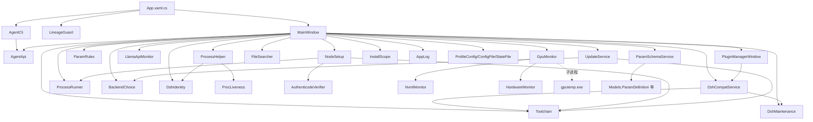

# 03 Windows 端：LlamaDSH_Launcher_CS

.NET 8 WPF 主程序，约 3 万行源码（C# ≈ 2.9 万行）。特点：MainWindow 单文件承载几乎全部业务（1.1 万行）；25 个 Services 提供可独立测试的能力；代码注释以「事故复盘」为主（含实测日期），是理解设计决策的第一手素材。

## 项目文件（LlamaDSH_Launcher.csproj）

- `net8.0-windows`，`WinExe`，`UseWPF` + `UseWindowsForms`（仅用 NotifyIcon/ContextMenuStrip 做托盘，`<Using Remove>` 移除 WinForms/Drawing 全局 using），x64。
- **`AllowUnsafeBlocks=true` 必须保留**：`App.xaml.cs` 的 `[LibraryImport]` 源生成器产出 unsafe 代码，删掉全项目编译失败。
- NuGet：`System.Management`（WMI）、`System.Drawing.Common`（托盘图标）、`YamlDotNet`（参数表）、`LibreHardwareMonitorLib`（GPU/CPU 传感器）。
- 嵌入资源：`Resources/conversion_kit.zip`（safetensors 转换工具包）、`Resources/llama_params.yml`、`Resources/GameAccessProbe.ps1`（提权 DSH 链的句柄探针）。Content 拷贝：`app.ico`、`gputemp/gputemp.exe`。
- 版本字段 `Version=1.1.3` —— 真源在 `installer.iss`，打包脚本同步。

## 启动流程（App.xaml.cs，201 行）

`OnStartup` 顺序固定，每步都有事故背景：

1. **cli 分流**：`args[0]=="cli"` 直接 `Environment.Exit(AgentCli.Run(args))`——在任何启动逻辑之前，不触发血统重启/单实例。
2. **血统检测与切断**（`LineageGuard.Decide`）：Inno 装完自动启动会遗留 `__COMPAT_LAYER=ElevateCreateProcess` 血统，导致本进程发起的 WMI 必失败。判定为安装器血统 → 写一次性 marker（fail-closed，写失败绝不重启）→ 经 `explorer.exe "<exe>"`（**不能带参数**，实测 explorer 加参数不拉起）以干净血统重启；marker 已存在 → `CappedAlreadyReset`（一次封顶，防无限反复启动）。
3. `RenderOptions.ProcessRenderMode = SoftwareOnly` —— AMD 驱动长跑 WPF 泄漏显存导致崩溃。
4. `SetProcessDpiAwareness(2)`。
5. 后台 `AppLog.ScrubExisting()` 清洗历史日志中的凭据（不挡启动）。
6. **单实例 mutex**：`LlamaDSH_Launcher_SingleInstance_Mutex`，重试 3 次 ×300ms（explorer 重启竞态），`AbandonedMutexException` 接管（旧实例崩溃后仍能打开）。
7. **三重异常兜底**：Dispatcher / AppDomain / TaskScheduler 三处未处理异常都写 crash.log，前两者弹窗。
8. `ShutdownMode = OnExplicitShutdown`，退出由托盘/窗口逻辑显式控制。

## MainWindow（11358 行）

### XAML 布局（MainWindow.xaml，746 行）

- 左列（0.73\*）：配置文件操作条 → 方案操作条 → 三个浏览器式标签：
  - **运行环境**：模型文件（主模型/MTP/mmproj）、程序目录（Llama 目录 + 变体 + 后端下拉、DSH 目录）、DSH 选项（启动模式/管理员模式/兼容与插件按钮）、Node 环境卡。
  - **参数配置**：过滤框 + 左侧子组导航 + 面包屑 + 参数区（独立滚动）。
  - **命令预览**：完整命令文本框 + 自定义参数橙色回显。
- 右列：运行控制 GroupBox（Llama 启停、显存熔断、DSH 启停/重建/打开网页）→ `MainTabs`：
  - **监测**：摘要条、四张指标卡（SparkChart 迷你曲线 + MTP 环形仪表）、GPU 按卡面板、实时生成任务、事件流、系统资源（分核柱）、11 张 TrendChart 趋势图。
  - **运行日志**：LogArea + 清空/打开目录/自动滚动。
- 底部非模态 `NoticeBar`（替代信息类 MessageBox，8s/12s 自动隐藏）。

### 构造与初始化（约 206-291 行）

字段初始化 → `ParamSchemaService.Load()` → 读配置目录指针 → `InitializeComponent()` → `BuildParamGroups()`（动态构建参数面板）→ `SetupTray()` → `WireLiveRefresh()`（输入联动刷新命令预览）→ `StartPerfMonitor()`（采集线程）→ `LoadState()`（接管 llama/DSH）→ `ApplyAdminModeScopeHint()`（按 InstallScope 刷新提权提示）→ `TryStartAgentApi()` → 启动 `_healthTimer`（5s 对账）与 `_logTimer`（100ms 日志 flush）。

### 核心字段

- 进程：`_llamaProc`、`_dshProc`、`_dshTracker`（ProcessTracker）、`_dshAdminMode`
- 服务实例：`_gpuMonitor`、`_llamaApi`（LlamaApiMonitor，端口 getter 闭包）、`_agentApi`
- 线程：`_perfThread`+`_perfCts`（采集）、`_healthTimer`、`_logTimer`、`_dshVerifyTimer`（DSH 启动验证）、`_dshRebuildTimer`（HEAD 变化轮询）
- 参数系统：`_paramDefs/_paramSchema/_paramGroups`、`_pw/_pbw`（控件字典）、`_paramRows`（过滤索引）
- 日志：`_runRing`（2000 条环形缓冲）、`_runLogSeq/_runLogFlushedSeq`
- 配置：`_profiles`、`_currentProfile`、`_configDir`
- 轻量化 volatile 标志集中区（7313-7332 行）：`_monitorTabVisible/_trayMode/_lightOn/_perfPulse/_brkEnabledCache/_brkTypeGbCache/_brkThrBits`

### 主要方法分组（行号为当前文件位置）

| 功能组 | 方法 |
|---|---|
| 参数面板 | `BuildParamGroups`(293)、`SelectSubgroup`(532)、`ApplyParamFilter`(586)、`IsEffectivelyOn`(705)、`EffectiveValue`(720)、`IsSpecDecodingActive`(748)、`RuleMet`(758)、`EvaluateDepUI`(786)、`CheckParam`(898) |
| 命令组装/GGUF/显存 | `BuildCmd`(2709)、`ReadGgufArch`(2862)、`ReadGgufTensorStats`(3162)、`ConfirmVramFit`(3502)、`RefreshCmdNow`(3670)、`ApplyCmdEdit/ValidateCustomArgs/SplitCommandLine`(3754-3951)、`ReloadSchema_Click`(3951) |
| safetensors 转换 | `ExtractConversionKit`(4032)、`ConvertSafetensors`(4091)、`EnsureConvertAndLaunchAsync`(4322)、`StartDetachedConversion`(4408)、`PollDetachedConversion`(4512) |
| Llama 启停 | `StartLlama`(4623)、`VerifyLlama`(4773)、`OnLlamaDone`(4800)、`StopLlama`(4858)、`IsLlamaRunning`(1798)、`NoteLlamaMemoryLine`(5404) |
| DSH 启停/重建 | `StartDsh_Click`(4944)、`RebuildDsh_Click`(4983)、`PrepareDshThenStart`(5047)、`StartDshRebuild/PollDshRebuild`(5154/5300)、`StartDsh`(5464)、`TryStartDshElevated`(5749)、`StartDshVerifyLoop/VerifyDsh`(5861/5967)、`OnDshDone`(6014)、`StopDsh`(6099)、`AttachDsh`(8884)、`DshBootLogHasModuleMissing`(5448，node_modules 自愈触发) |
| DSH 兼容/更新 | `CheckDshCompatAsync/RunDshCompatRepairAsync`(2126-2297)、`CheckDshPluginsAsync`(2297)、`CheckLlamaUpdateAsync/CheckDshUpdateAsync`(1863/1975)、`StartBackgroundUpdateCheck`(2447)、`AddLlamaVariant_Click`(1406) |
| 目录发现 | `EnsureDirsDetected`(1690)、`StartBackgroundDshSearch/LlamaSearch`(1738/1771)、`EffectiveLlamaDir/EffectiveDshDir`(1661/1679) |
| 日志区 | `PumpProcessStreams`(6362)、`FlushLogs`(6411)、`IsDshNoise`(6515)、`AppendRunLog`(6585)、`FlushRunLog`(6656)、`Log/LogError`(6742/6632)、`CopyDiagInfo_Click`(6668)、`ShowNotice`(6690) |
| 监测/性能线程 | `StartPerfMonitor`(6792，三档节奏 + 3s NVML 熔断探针)、`HeavySample`(7031)、`OnPerf`(8140)、`TrayLightPerf`(7988)、`CheckVramBreaker`(8096)、`HealthCheck`(8672)、`GetLlamaPort/CacheLlamaPort`(7260/7288)、`UpdatePhaseCard`(7453)、`PushChart`(7438) |
| 托盘/轻量化/退出 | `SetupTray`(903)、`ShowFromTray`(951)、`EnterTrayLightMode/ExitTrayLightMode`(961/984，进出 GC.Collect)、`QuitApp/ExitCore`(1036/1069)、`Window_Closing`(9944，勾托盘时 Hide) |
| 方案/配置 | `BuildConfig/ApplyConfig`(9048/9102)、`SaveConfigFile/LoadConfigFile`(9196/9267，损坏留 `.corrupt-*.bak`)、`SaveProfile 系列`(9474-9655)、`SaveState/LoadState`(8708/8746)、`WriteTextAtomic`(8968) |
| Node 安装 | `InstallNodeEnv_Click`(9766)、`RefreshNodeStatusAsync`(9716)、`NodeLogLine`(9687) |
| Agent 端点宿主 | `TryStartAgentApi`(9992，注册全部路由)、`AgentRunJob`(10096)、各 `Agent*Op`、`AgentOp`(11211，30s 超时 marshal 到 UI 线程) |
| 模型自动填充 | `AutoFill`(2525)、`ResolveModelPath`(2637) |

## Services（25 个文件）

| 文件 | 行数 | 职责与要点 |
|---|---|---|
| `Logging.cs`（根） | 329 | `static AppLog`。`%USERPROFILE%\.dsh_launcher_logs` 四类日志；`BootId`（游标跨重启检测）；`Redact/RedactBytes`（三类凭据掩码，字节级不损非法 UTF-8）；`ScrubExisting()` 历史清洗；`Tail` 末尾倒读；4MB 轮转。全部 IO 吞异常。 |
| `Services/ProcessRunner.cs` | 168 | 统一子进程执行器。`Run(...)`：Start → 双流 ReadToEndAsync → WaitForExit(timeout) → Kill(true) → 限时 Drain（孙进程继承句柄防吊死）。参数走 `ArgumentList` 免注入。**同步阻塞，勿在 UI 线程等长任务**。 |
| `Services/ProcessHelper.cs` | 472 | `KillProcessTree`（内核整树终止，防收集/击杀间 PID 复用误杀）；`FindProcessByPort`（iphlpapi 优先、netstat 回退，**不限进程名**）；`FindOrphanedDshProcesses`（打分扫描，15s 缓存）；`DshIdentityProbe`（分层身份判定）。 |
| `Services/ProcessTracker.cs` | 46 | `Pid + StartTime` 轻量存活跟踪；`Poll()` 返回 null=活、-1=退出或 PID 被换。 |
| `Services/ProcLiveness.cs` | 95 | **子进程存活判定唯一入口**：`Alive`（HasExited 抛异常一律按已退出——修掉「No process is associated」刷屏）；`PidAlive`（复用防护）；`SafeDispose`。 |
| `Services/Toolchain.cs` | 880 | 工具链/目录发现（带 30s TTL 缓存）。`IsDshDir`（pnpm-workspace.yaml + apps/cli）；`ResolveDshDir` 五级链（状态文件→运行中命令行→profile junction→已知位置→全盘）；`ResolveNode24Exe` 候选链覆盖 nvm/scoop/winget/Volta/fnm；`AugmentPath`（给子进程补 PATH，解决「终端能跑、启动器里找不到」）。 |
| `Services/FileSearcher.cs` | 696 | 显式触发的全盘检索：`FindLlamaServer`（60s 限时）、`FindDshProject`（45s）、`ProbeKnown*` 快探。并发 BFS + node_modules/.git 剪枝。 |
| `Services/NodeSetup.cs` | 667 | Node/pnpm 一键安装。`VerifyMsiAsync` 双门：**Authenticode 验签前置**（主体须 OpenJS/Node.js Foundation）+ SHA-256（官方优先镜像回退）；`InstallMsi`（msiexec /passive，ArgumentList 防注入，3010/1641=成功需重启）；`InstallPnpm` 装完实跑 `--version` 验证。 |
| `Services/UpdateService.cs` | 1395 | llama.cpp 预编译包更新（`FetchLatestLlamaRelease` + `AnchorReleaseDigests` 官方锚定 + size/sha256 校验 + 运行中拒绝覆盖）与 DSH git 更新（`PullFastForward` ff-only + stash 保护链 + 镜像 fetch + `ExplainGitFailure` 中文化）。 |
| `Services/DshCompatService.cs` | 5424 | DSH 兼容审计/修复 + 插件管理后端（Services 中最大）。`Audit` 总入口（版本/HEAD/node/pnpm/dump-config/bundle 激活表/补丁失效/peer 依赖/悬空 junction/注入比对/市场日志）；`Repair` 逐项修复（自动备份）；插件操作 `SetBundleActive/PinInactive/UpgradePlugin/UninstallPlugin/InstallLocalPlugin/ExemptPlugin`；`SemverUtil` 完整 semver（^ ~ x-range）。同步方法，UI 用 `Task.Run` 包裹。 |
| `Services/DshMaintenance.cs` | 145 | 残留锁判定（锁文件+端口无监听+无 node 进程三者同时成立）；`BuildStatePath` 重建基线（`~/.llamadsh_dsh_build.json`）；`GetGitHead`（`GIT_TERMINAL_PROMPT=0`）。 |
| `Services/DshIdentity.cs` | 125 | 三层身份判定纯函数 `Judge` + `HttpFingerprint`（401 + "dsh web authentication required" 特征；true/false/null 三态；**必须非 UI 线程调用**）。常量 `DshPort=3080`。 |
| `Services/LineageGuard.cs` | 171 | 血统判定：`LooksLikeInstallerLayer`（**白名单**，RunAsInvoker 不算）；`Decide → NoResetNeeded/Relaunch/CappedAlreadyReset`；marker 写入先拒 reparse point + 回读校验（fail-closed）；marker 目录用 `%LOCALAPPDATA%` 而非共享可写的 `%TEMP%`（固定名 marker 的预置/符号链接攻击面）。 |
| `Services/InstallScope.cs` | 330 | 用户级/机器级安装判定：exe 旁 `install-scope.txt`（dir 须匹配防复制带跑）→ 卸载注册表 → 兜底 machine；`InstallDirWritable` 实测探针；`UacFact` 读 EnableLUA/ConsentPromptBehaviorAdmin。卸载键 GUID 与 iss/App.xaml 三处一致由 selftest §C 把关。 |
| `Services/AuthenticodeVerifier.cs` | 197 | `WinVerifyTrust` P/Invoke（UI_NONE、缓存吊销、VERIFY 后必须 CLOSE）；HRESULT 中文化；`TryGetSubject` 只取展示用 Subject（不验签）。异常一律归为不可信。 |
| `Services/BackendChoice.cs` | 83 | 后端口径：`Known={vulkan,rocm,cuda,sycl}`；`Resolve`（显式优先否则自动兜底 vulkan）；`FallbackTokens`（GitHub 资产 token 匹配链，rocm 要带 `-`；CPU 资产新旧名兜底）。 |
| `Services/GpuMonitor.cs` | 1288 | GPU 指标聚合门面。通道矩阵：NVIDIA=NVML→nvidia-smi；AMD=amd-smi/rocm-smi→CIM+注册表 VRAM 总量；Intel=xpu-smi→CIM；温度兜底链 gputemp 子进程→LHM→PowerShell 脚本（60s 限频）→CPU 温度。`ReapStaleGpuTempLoops` 清理孤儿 gputemp。 |
| `Services/NvmlMonitor.cs` | 553 | NVML 进程内直采（`partial class`：P/Invoke 绑定 + 逐卡采样 + nvidia-smi 回退）。`SamplePerDevice` 是熔断 3s 探针专用（零子进程）。延迟 LoadLibrary，失败只记一次。 |
| `Services/HardwareMonitor.cs` | 234 | LibreHardwareMonitor 单例门面。多卡聚合（负载/风扇/频率均值、功率求和、温度最高）；**Sample 全程锁内**（LHM 不支持并发 Update，否则传感器读数错乱）。 |
| `Services/LlamaApiMonitor.cs` | 947 | llama-server API/日志采集。构造传 `Func<int> portGetter`；`PollFast`（/slots 差分出「开始解码/完成/预填充」事件）、`PollSlowIfNeeded`（/props /models 30s 节流）、`FeedLogLine`（timing 解析算 TPS）；`CandidatePorts` 自动发现。由 perf 线程驱动。 |
| `Services/TrendChart.cs` | 437 | 多序列趋势折线图控件（直绘、悬停十字线、自动量程）。XAML 实例化 11 个。 |
| `Services/SparkChart.cs` | 356 | 迷你火花线控件（Strata 复刻）。坑：读数条必须不参与布局（否则悬停→增高→脱离→收起死循环）。 |
| `Services/ParamSchemaService.cs` | 523 | 三层 schema 加载（内置嵌入资源 → exe 旁 → `~/.llamadsh/params_override.yml` 差异覆盖）；`meta.schema` 升级自动备份；`ExePath` 用 `Environment.ProcessPath`（单文件发布下 `AppContext.BaseDirectory` 指向解压临时目录）；`MigrateProfileFlags`（aliases 迁移）。 |
| `Services/ParamRules.cs` | 262 | 规则引擎与命令组装：`IParamState` 接口（MainWindow 实现，规则引擎可脱离 WPF 单测）；`RuleMet/RequiresMet/CheckParam`；`Build`（**头号回归约束：前置未满足的参数整条不参与命令行，连 offValue/offFlag 也不发射**）；`NormTok`（128k/1M→数字）。 |
| `Services/AgentApi.cs` | 401 | 本机 HTTP 控制面。HttpListener 只绑 127.0.0.1；`RegisterGet/RegisterPost`（本类不感知 UI，宿主注册委托）；token 用 `CryptographicOperations.FixedTimeEquals`；Host 环回校验；体上限 262144 超限 413；`TightenAcl` 收紧 agent.json DACL + Hidden。默认端口 17325。 |
| `Services/AgentCli.cs` | 428 | `cli` 子命令实现。`AttachConsole` 挂回父控制台（GUI 进程默认无 stdout）；`TryParse` 命令→HTTP 映射（独立便于冒烟测试）；退出码 0 成功 / 1 业务失败 / 2 不可达 / 3 超时（结果未知）。 |

## Models（9 个文件）

| 文件 | 内容 |
|---|---|
| `ParamDefinition.cs` | 单参数定义（163 行）：Label/Flag/**Role**/Type/DefaultValue/Group/OffValue/OffFlag/Wide/Options/Tooltip/Requires/Conflicts/Implies/Validate/Aliases/Hidden/Deprecated。静态 `ValidateSchema` 只降级不抛。 |
| `ParamRule.cs` | 前置规则 `Flag/Op/Value`，`IsSupportedOp` 白名单，`Describe()` 中文化。 |
| `ParamType.cs` / `ParamValidate.cs` | `enum {String, Bool, Combo}`；`{Min, Max, Leq, Regex}`。 |
| `ProfileConfig.cs` | 单套方案（87 行）：模型路径族、LlamaDir/**LlamaBackend**、DshDir/DshMode/DshAdminMode(默认 true)、BoolParams/ValueParams、VramBreaker 三键、LlamaVariants/ActiveLlamaVariant、CustomArgs、VramMeasured* 实测缓存。**`[JsonExtensionData] Extra` 保住跨端字段**。 |
| `ConfigFile.cs` | `{Profiles, CurrentProfile, WindowWidth, WindowHeight}`；宽高 ≤100 回退 1400×950。 |
| `StateFile.cs` / `ConfigPathFile.cs` / `ValueParamData.cs` | 接管状态 `{LlamaPid, DshPid, DshDir}`；配置目录指针 `{Dir}`；值参数 `{Enabled, Value}`。 |

## Resources

- `Resources/llama_params.yml`（2638 行）：参数表真源。`meta.notes` 写明维护手册（对齐方法：`llama-server --help` 全量 diff，332 选项 vs 241 参数 + aliases）。
- `Resources/conversion_kit.zip`：safetensors→GGUF 转换工具包。
- `Resources/GameAccessProbe.ps1`：提权 DSH 链的 `EliteDangerous64` 句柄探针（ASCII-only，结果追加到 boot log）。
- `Resources/app.ico`：应用/托盘图标。

## PluginManagerWindow（483 行）

基于 `DshCompatService.Audit` 的插件管理窗口。构造即 `SafeRefreshAsync()`（审计十几秒，Task.Run）。行操作：激活 / 停用并锁定（`PinInactive`，对抗 DSH 网页端自动写回）/ 升级（先 `PreviewPluginUpdate` 预检）/ 版本豁免（`ExemptPlugin`）/ 卸载 / 本地安装（目录自动 `pnpm pack`）。守卫：`RequireDshStopped()`（DSH 运行中拒绝 pnpm 写操作，模态确认框）；`SetBusy` 保证「点了没反应」有可见状态。

## 模块依赖图

文字版主链：`App → LineageGuard / AgentCli / MainWindow`；`MainWindow → 几乎全部 Services`；日志 `AppLog` 横切全部；`ParamRules` 通过 `IParamState` 接口与 MainWindow 双向（MainWindow 实现控件态，规则引擎输出命令行）。

## 已知坑与注意事项（注释明示）

1. **线程守卫**：UI 写入必须 Dispatcher；perf 线程循环内捕获局部 `perfCts` 引用（共享字段被置 null 后重读会 NRE）；轻量化标志全 volatile，熔断探针只做门控、终判在 UI 线程复核；`HardwareMonitor.Sample` 全程锁内；`HttpFingerprint` 禁止 UI 线程调用。
2. **端口发现四级回退**：UI 缓存 → `--port` 正则 → ActivePort → 默认三端口重扫。「多面板同时无数据」先查端口。
3. **`FindProcessByPort` 不限进程名**（限了会让端口预检在降级机器失效），因此身份校验必须另做，否则停止会杀用户进程树。
4. **单文件发布**：取 exe 真实目录一律 `Environment.ProcessPath`，`AppContext.BaseDirectory` 指向自解压临时目录。
5. **子进程顺序**：先 ReadToEndAsync 双流再 WaitForExit（倒序超时失效/管道互锁）；Drain 限时；.cmd/.bat 要 `cmd /c`。
6. **WMI 命令行缓存**：空结果只缓存 2 秒（10 秒会把「读不到」固化成判定依据）。
7. **原子写**：临时文件名必须唯一（固定 .tmp 多写者会互相抛异常静默丢保存）；损坏配置先备份 `.corrupt-*.bak`。
8. **日志脱敏按字节**：`RedactBytes` 用 ISO-8859-1 往返，`File.ReadAllText` 会把非法 UTF-8 永久变 U+FFFD。
9. **schema 升级**：`meta.schema` 单调递增 + 自动备份 `.bak`；aliases 迁移旧 profile 键。
10. **渲染**：SoftwareOnly 强制；进出轻量化触发 `GC.Collect(2, Forced)`。
