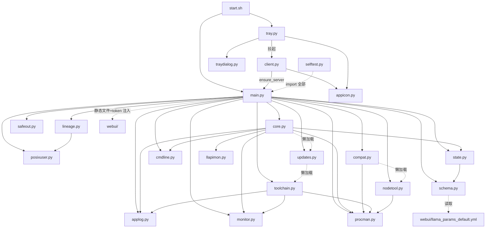

# 04 Linux 端：LlamaDSH_Launcher_Linux

Windows 端的 Linux 复刻版：Python 3 标准库 + PyYAML（必需），以本地 WebUI 为主界面，GTK/WebKit 窗口可逐级降级为纯浏览器。约 1.7 万行，其中 `selftest.py` 占 5055 行（385 处 check 断言）。代码注释密度极高，几乎每条「为什么」都对应一个实测 bug。

## 运行形态：三进程模型

```
start.sh
 ├─ python3 tray.py          # SNI 托盘常驻（~25-30MB，不导 GTK）
 │    ├─ 拉起 client.py --url  # GTK/WebKit 窗口壳
 │    └─ ensure_server() 拉起 main.py
 ├─ 降级链：tray.py 退出码 2（无会话总线/SSH）→ 直接跑 main.py + xdg-open 浏览器
 └─ python3 main.py [-p 端口]  # 核心：HTTP 服务 + 路由 + 采集
```

- `main.py` 内部：`ThreadingHTTPServer`（每请求一线程）+ 常驻线程 `MON.loop`（监控/熔断）与 `_health_loop`（5s 对账）+ 任务线程（`run_job`）。
- llama-server 以 `subprocess.Popen`（PIPE）直启；DSH 以 `start_new_session=True` **分离会话**启动——关窗/退出不影响 llama/DSH 继续跑。
- 单实例：`~/.llamadsh_launcher_linux.lock`（fcntl flock）。

## 模块清单（22 个 .py）

### 入口与基础设施

| 模块 | 行数 | 职责与关键点 |
|---|---|---|
| `main.py` | 1676 | 进程入口 + HTTP 服务。定义 49 个 `api_*` 处理器与 50 条 `ROUTES` 路由；`Handler(BaseHTTPRequestHandler)`（Host 白名单、X-Auth 鉴权、`_body_shape_error` 类型守卫、10MB 上限）；`startup_log_and_scrub`（血统切完后才打横幅+历史脱敏）；`takeover_on_boot`（开机接管：llama 按 PID+进程名，DSH 按端口→state→孤儿扫描）；`run_job` 任务模型（保留最近 20 个，出口 `_redact_deep` 脱敏）；`_stop_all_and_exit`（幂等闩 + 45s 看门狗）。常量：`DSH_PORT=3080`、`DEFAULT_PORT=8788`（被占顺延最多 20）、`TOKEN_FILE=~/.dsh_launcher_token`、`AGENT_FILE=~/.dsh_launcher_logs/agent.json`。 |
| `lineage.py` | 61 | sudo 血统切换：`reset_if_sudo()` 在 euid==0 且有 `SUDO_USER` 时 `execvp("sudo -u user …")` 切回真实用户；`LlamaDSH_LINEAGE_RESET=1` 一次封顶防无限自重启；**必须先于任何 import `expanduser("~")` 的模块调用**（selftest §32 源码级断言守着）。 |
| `posixuser.py` | 34 | `user_home`（查 passwd，不捏造路径——LDAP/自定义家目录）；`sudo_initiator`。 |
| `safeout.py` | 27 | stdout/stderr `reconfigure(errors="backslashreplace")`——防 GBK/ASCII 控制台上打 Unicode 变启动失败。 |
| `applog.py` | 167 | `~/.dsh_launcher_logs/{run,info,error,crash}.log`；`redact()` 三形态脱敏；`scrub_existing()` **按字节**重写历史日志（tmp+os.replace）；4MB 滚动 `.1/.2/.3`；全部 IO 吞异常。 |
| `appicon.py` | 230 | 图标自举：铺 hicolor 各尺寸 + 补 `index.theme`（缺了整目录被 GTK/Shell 忽略）；手写 zlib 解 PNG→ARGB32 供 SNI IconPixmap。 |
| `state.py` | 229 | 配置/状态持久化：`load_config/save_config`（逐 profile 以 default 打底合并；损坏留底 `.corrupt-*.bak`）；`update_state` **合并写**（防单键全量写抹掉 DshPid）；配置目录指针 `~/.llamadsh_config_path.json`。 |
| `schema.py` | 256 | 参数 schema 三层加载：内置 `webui/llama_params_default.yml` → 程序旁 `llama_params.yml`（版本升级自动备份）→ `~/.llamadsh/params_override.yml` 差异覆盖；引用校验/正则预编译/组排序；`migrate_profile_flags`（aliases 迁移）。 |

### 核心运行时（core.py，1359 行）

| 类 | 职责 |
|---|---|
| `LogHub` | 2000 条环形缓冲 `(seq, level, text)`；`log` 管线：脱敏→相邻去重→DSH 噪音折叠（`is_dsh_noise` 白名单）→applog.run；`boot=时间戳-pid`；`since(after)`/`seq_first_available` 游标。 |
| `LlamaRunner` | `_start_lock` 防 TOCTOU；`precheck` 确认链（safetensors/模型存在/端口占用/vram → kind ∈ safetensors/empty/build_error/confirm/ok）；`cache_port_from_profile` 线程安全端口缓存（**采集线程不读控件**，历史事故修复）；Popen + 双 pump 喂 `LlamaApiMonitor.feed_log_line`；`_wait_exit` 用 `user_stopped` 区分 SIGTERM 与崩溃；`stop` 三态（stopped/stop_failed）。 |
| `DshRunner` | `resolve_mode`（npx / compiled-js / compiled-tsx）；启动前清残留锁 + 重建基线比对（`need_rebuild`）；`_sudo_preflight`（NoNewPrivs/密码两类原因）+ 提权降级；`_spawn` 分离会话写 boot log；`_tail_loop`（0.4s 尾随）+ `_verify_loop`（2s 探端口，`ERR_MODULE_NOT_FOUND` 快速失败自动重试 2 次）；`rebuild`（pnpm clean→build:lib→vite build，EXITCODE 标记，30 分钟超时）；`stop` 带 PID 复用防线 + sudo kill 兜底。 |
| `Monitor` | 三档 `_cadence`（full 3s / light+服务 30s / light+无服务 60s 纯休眠）；长休眠每 ≤5s 醒一次复查档位；`_watched` 8s 时效；熔断判定（百分比/GB 两种，命中闩存+停 llama）；`_build_snapshot`（12 条 Hist 序列+事件流+slots+sampled_at）。 |
| `Converter` | safetensors→GGUF：`outtype` 白名单 f16/f32/q8_0；启动走 argv 列表不经 shell（注释记录 `f16; echo X #` 注入实测）；磁盘预检；pip 依赖自动装（清华源→pypi）；nice -n 10 分离 bash；字节级半行安全尾随 + 3h 超时。 |

### 功能模块

| 模块 | 行数 | 职责 |
|---|---|---|
| `compat.py` | 2463 | DSH 审计/修复/插件管理（对齐 Windows DshCompatService）：`audit`→{items,fixables,version,probes}；`repair`（先重审防陈旧快照）；`_semver_cmp/semver_satisfies`（完整 caret/tilde/x/`||`/prerelease）；bundle 激活守卫、锁定停用（pinned）、死依赖判定（仅 `@deepseek-ai/*`）、版本豁免门禁 `evaluate_gate`；`install_local_plugin`（失败回滚 manifest+lock）；`begin_profile_op` profile 级 RLock 串行化 pnpm 写操作。 |
| `toolchain.py` | 968 | llama.cpp 变体/后端/预编译包：`gh_api` 直连 + 3 镜像（候选粘滞 + 冷却 240s/60s）；`parse_build_from_tag`（b12345/prism-bNNNNN-hex）；`backend_preference`（NVIDIA=cuda / Intel Arc=sycl / AMD=vulkan）；`pick_assets`（rocm→vulkan→cpu 回退，cuda 配对 cudart）；`anchor_release_digests`（防镜像投毒）；`apply_llama_update`（.part 原子改名 + size ±1% 对账 + build 硬校验）。 |
| `cmdline.py` | 948 | `ParamState`（等价 CS `_pbw/_pw` 控件态）；规则引擎（requires/conflicts/implies/validate）；`read_gguf_arch`（**手写 GGUF 解析**：layers/kv_heads/head_dim/SWA/SSM/full_attention_interval）；`build_cmd`（主流程 + offValue/offFlag + CustomArgs）；`estimate_vram_needed`（权重×0.95 + KV + 计算图 + 300MiB 基线 + mmproj + 草稿；`fits` 三态）；`qwen35_partial_offload_warning`。纯标准库。 |
| `llapimon.py` | 680 | llama-server 采集：13 条日志正则状态机（timing/prefill/draft/graphs）；`poll_fast`（/slots 差分，盲扫 8080/8081/1234，3 连败判离线）；`poll_slow_if_needed`（/props /models 30s 节流）；OOM 标记识别。纯标准库。 |
| `monitor.py` | 513 | 系统/GPU 采样（1s 缓存）：/proc/stat 差分 CPU、/proc/diskstats、/proc/net/dev；`detect_vendor`（nvidia-smi→amd-smi/rocm-smi→xpu-smi→/sys/class/drm，300s 缓存）；NVIDIA 走 14 列逐卡查询，无厂商工具时 sysfs+hwmon 合成单卡（`synthetic: True`）。 |
| `nodetool.py` | 373 | Node24/pnpm：`_node_candidates`（PATH/~/.nvm/fnm/volta/snap）；`latest_v24`（120s 缓存 + 版本形态白名单防注入）；`install_node_env`（先取 SHASUMS256 校验、解压 `~/.local/lib/nodejs-vX`、bin 软链 `~/.local/bin`、pnpm 优先 corepack）。 |
| `updates.py` | 453 | 自动检索（`_bfs` 优先队列，45s deadline）；`find_dsh_project`（pnpm-workspace.yaml）；llama 更新委托 toolchain；`dsh_pull`（pull --ff-only + stash 保护 + 镜像 fetch + merge）；`_cleanup_git_lock`（按 /proc/<pid>/cwd 比对才删 index.lock）。 |
| `procman.py` | 352 | /proc 进程管理：`kill_process_tree`（叶子先死，SIGTERM→SIGKILL；树枚举不出不得谎报已停止）；`find_process_by_port`（ss -ltnp，**不限进程名**——Node 24 主线程 comm 是 "MainThread"）；`ProcessTracker`（PID+StartTime）；`find_orphaned_dsh_processes`（打分）；**`dsh_identity` 三层判定**（进程名→cmdline 特征→HTTP 指纹），与 Windows DshIdentity 同款。 |
| `client.py` | 343 | GTK/WebKit 窗口壳：`ensure_server`（顺延端口扫描 + detached 拉起 main.py）；WebKit2 独立数据目录；内部导航放行、外链交 xdg-open；`create` 信号必须接（window.open 不接被 WebKit 静默吞）；关窗=置轻量化+进程退出；窗口锁 fcntl 单例。GTK 缺失降级 xdg-open。 |
| `tray.py` | 780 | SNI + dbusmenu **纯 Python 最小实现**（`org.kde.StatusNotifierItem` + `com.canonical.dbusmenu`；D-Bus 签名严格按规范，错则右键空菜单）。菜单：显示/轻量化复选（状态从 /api/status 读回）/退出（`traydialog` 子进程二次确认 → `/api/shutdown` → 45s 超时按锁 PID+realpath 兜底 SIGTERM）。 |
| `traydialog.py` | 109 | 一次性 GTK 确认框子进程：`--check/--respond <标签>/--delay`；`--respond` 标签找不到不得静默按取消（防回归假绿）。 |
| `selftest.py` | 5055 | 回归自检，385 处 check 断言（见下节）。 |
| `selftest_lineage_shim.py` | 121 | Windows 上跑 selftest §31/§32 的 shim：伪造 fcntl/pwd/geteuid，按小节标题切片 exec selftest.py 源码。 |

## WebUI（webui/）

| 文件 | 说明 |
|---|---|
| `index.html`（361 行） | 页面骨架：顶栏（保存/另存/加载/配置目录）+ 方案下拉；左栏三标签（运行环境 / 参数配置（过滤+子组导航+面包屑）/ 命令预览）；右栏运行控制 + mainTabs（监测：摘要条/4 张指标卡/GPU 按卡面板/事件流/系统 2×2/11 张趋势图；运行日志）。 |
| `app.js`（1932 行） | 全部交互。核心 `api(path, body)` = POST `/api/<端点>` + `X-Auth: window.__DSH_TOKEN`（服务端注入 index.html）；`pollLogs`（after 游标增量）、`pollStatus`、`pollMonitor`（页签可见才 3s 拉，`visible:false` 通知降频，帧龄 >15s 显示「轻量化驻留」）；`startLlama` 确认链三段（转换目录选择→confirm.done 重发）；`pluginManager` 逐插件行内按钮。 |
| `style.css`（376 行） | 暗色主题；两行式参数行（输入行+回显行，绿=已发射/灰=预览）；122×30 统一按钮。 |
| `llama_params_default.yml`（89KB） | 内置 schema 兜底副本。 |

## HTTP API

服务端细节与完整端点表见 [07-Agent-API与CLI](07-Agent-API与CLI.md)。要点：默认端口 8788 顺延；`agent.json`（0600）绑定成功后才写实际端口；`~/.dsh_launcher_token` 纯文本向后兼容（client.py/tray.py 用）；免 token 仅 `GET /api/ping` 与 `GET /api/status`；全部响应带 `ok`；业务失败 = 200 + `ok:false`。

## 构建与运行

- **运行**：`python3 main.py [-p 端口]` 或 `bash start.sh`（托盘模式优先，逐级降级）。依赖 Python 3.10+、pyyaml；python3-gi + gir1.2-webkit2-4.1（窗口）、python3-dbus（托盘）可选。
- **`install.sh`（71 行）**：用户级安装免 root → `~/.local/share/llamadsh-launcher`；依赖体检（pyyaml 缺失致命，GTK/dbus 缺失仅警告）；铺图标 + `.desktop`（StartupWMClass）+ 可选 autostart；生成 `uninstall.sh`。
- **`build_release.sh`（22 行）**：从 `installer.iss` 提版本号（取不到回退 1.1.0）→ staging 拷源码 + 生成 VERSION → `dist/LlamaDSH_Launcher_Linux_v<VER>.tar.gz`。
- **`start.sh`**：头部注释「请勿用 sudo——HOME 会错位」；即便如此 `main.py` 仍有 `lineage.reset_if_sudo()` 兜底切回真实用户。

## selftest.py（385 处 check 断言）

单文件顺序脚本 + `check(name, cond)` 收集 FAILS，失败非零退出。分节按「同步批次 + 历轮真实 bug 的 review 轮次」组织：基础单测（toolchain 资产名白名单、GGUF 手造解析、llapimon 正则状态机、Converter 半行尾随…）→ 行为级（托盘协议活体探针、本地插件安装回滚、兼容修复真跑）→ §31 血统封顶 / §32 启动顺序（源码级断言 main.py 的 import 顺序）。自约束：跑自检前把 `LOG_DIR` 挪到临时目录，不污染用户日志；`LlamaDSH_NO_LINEAGE_RESET=1` 防血统 exec 走人。跑法：`python3 selftest.py`。

## 模块依赖图



文字版启动链：`start.sh → tray.py → client.py → main.py → {lineage/posixuser/safeout → applog → schema → state → cmdline/llapimon/monitor/procman → core → compat/toolchain/updates/nodetool}`。

## 已知坑与注意事项（注释明示）

1. **import 顺序敏感**：`posixuser/safeout/lineage` 必须先 import 并调 `reset_if_sudo()`，再 import applog/core——否则 `sudo python3 main.py` 会先以 root 建日志目录、跑过脱敏再 exec。
2. **血统一次封顶** + 家目录必须查 passwd，不能拼 `/home/<user>`。
3. **`~/.local/bin` 常不在 PATH**（GNOME 自启/systemd-user/sudo），而 node/pnpm 装在这——`core._abs_exe`、`nodetool._pnpm_path`、重建脚本都必须解析绝对路径。
4. **Node 24 主线程 comm 是 "MainThread"**：按 "node" 过滤 /proc 永远查不到 DSH。
5. **探针三态**：`ss/lsof` 没装时「查不到」≠「端口空闲」——把 None 当 False 会删掉活实例的 ledger-v2.lock（实测踩过）。
6. **cmdline 读不到**（root 属主进程）：接管靠 HTTP 指纹兜底；`child_pids` 枚举不出 root 树返回 None（不是 []），`kill_process_tree` 只能保证打根 PID，不得谎报已停止。
7. **seq 游标跨启动失效**：每次进程启动从 1 重来，客户端必须比对 `boot`，否则永久读空且不报错。
8. **pnpm 写操作与 DSH 运行互斥**：`_dsh_running_guard` + profile RLock；`end_profile_op` 放锁与记账必须分开（锁泄漏=所有插件操作永久回忙）。
9. **/tmp 固定名+可执行** = 符号链接攻击面：已收进 `$TMPDIR/llamadsh-<uid>`（0700）私有命名空间。
10. **静态文件穿越**：`GET /../main.py` 旧写法可读出服务端源码，现按 realpath 归一比对。
11. **`estimate_vram` 的 fits 三态**：探针读不到显存时 `fits=None`，不能当 True 显示「在可用范围内」。
12. **轻量化快照停更**：`sampled_at`/帧龄提示是配套产物；`monitor_visible` 有 8s 时效，粘滞 True 会让降频失效。
13. **run.log 双时间戳**：applog 自带日期，LogHub 只补时刻——勿再叠一层。
14. **退出看门狗 45s**：预算必须大于 stop() 最坏合法路径 ≈32s（llama 探端口 10s+杀树 3s；DSH 杀树+sudo kill 15s+复核）。
